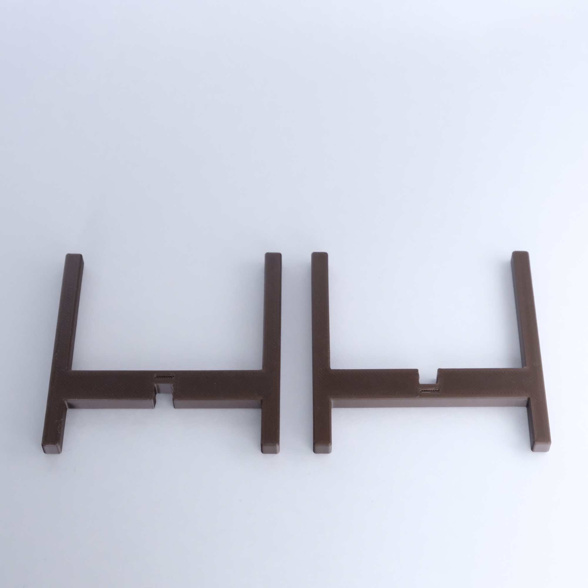
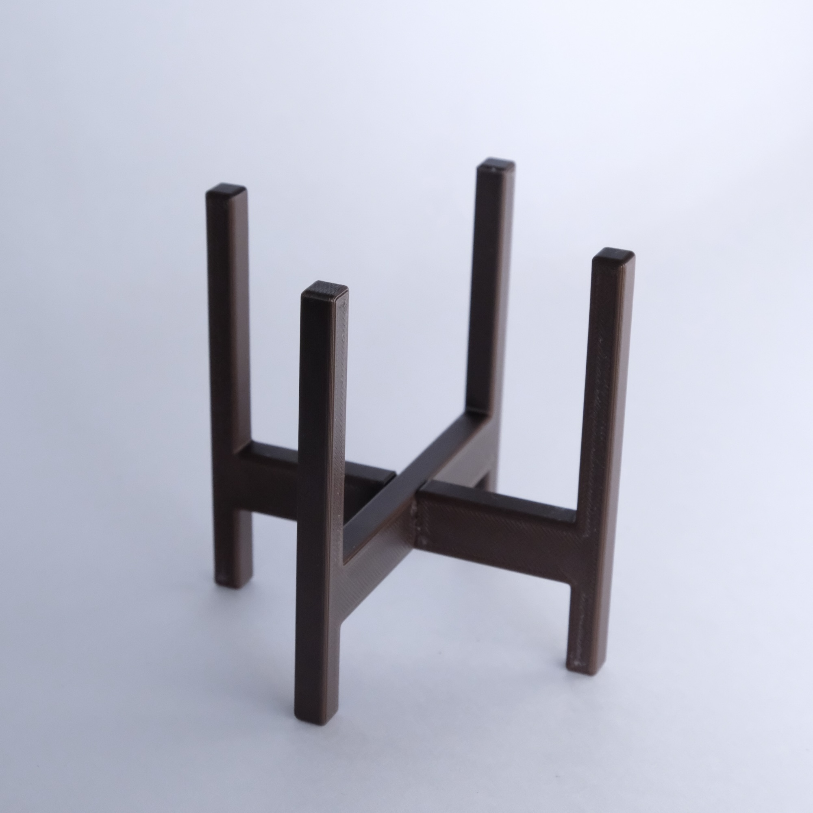
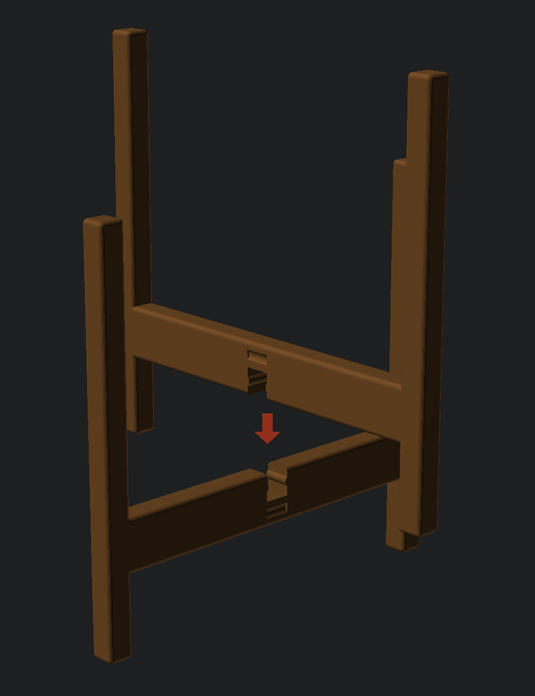
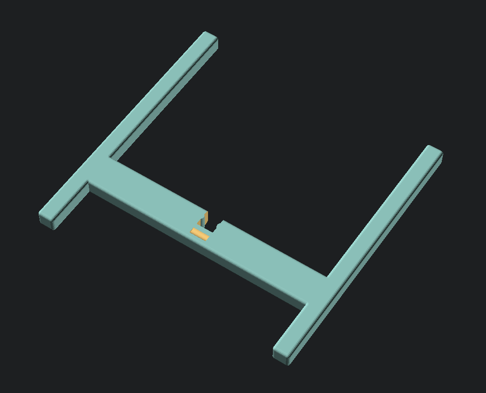

# Plant Pot Stand

A 3D printable stand for plant pots. Similar to traditional wooden designs.

|||
|-|-|
|||

## Printing

This model is designed to be printed on a standard consumer grade FDM printer using any standard filament such as PLA.

## Assembly

1. Align the notches on the top and bottom pieces of the stand.
2. Push the pieces together. They should loosely snap into place.

## Dimensions

By default, the export script will generate a stand for pots of 85mm, 125mm, and 175mm diameter. The diameter can be
adjusted in the export script, or directly by updating `default_pot_d` in `stand.scad`.

By default, the height of the stand is set dynamically based on the diameter of the pot it holders, but can be changed
in both the export script, or by updating `default_pot_d` in `stand.scad`.

## Models in this Project

|Image|Name|File|Description|
|-|-|-|-|
||`stand(is_top = true)`|`stand.scad`|The top of the stand.|
||`stand(is_top = false)`|`stand.scad`|The bottom of the stand.|

# Project Setup for Local Editing

Everything below this point is only relevant if you want to download this project and make edits.

## Cloning this Repository

This project uses a submodule for common SCAD code. If the submodule is not initialized, the `openscad-utilities`
directory will be empty, and the project won't render.

To get the submodule code when cloning, add the `--recurse-submodules` option to the clone command. For example:
> `git clone [Project URL] --recurse-submodules`

If you've already cloned the project, run this command in the project root to pull down the submodule:
> `git submodule update --init`

## Exporting Model Files

There are two options for exporting the models:

1. Through the provided [SCAD Export](https://github.com/CharlesLenk/scad_export) script.
2. Manually through the [OpenSCAD](https://openscad.org/) UI.

As of 2024, the OpenSCAD development preview uses a new rendering engine called Manifold. Using the development preview
with Manifold will render the models many times faster, regardless of how you export this project.

### 1. Exporting using the Script

The `export.py` script depends on SCAD Export. To set up SCAD Export and run the script, follow the
[SCAD Export quick start guide](https://github.com/CharlesLenk/scad-export/wiki/1.-Usage#quick-start).

### 2. Exporting Manually

The `export map.scad` file contains an `if/else` condition where the call to generate each model can be seen. You can
either write OpenSCAD code using these calls to build up a print plate, or the model "name" can be manually edited to
select each model, which can then be rendered and exported through the OpenSCAD UI like any other project.
